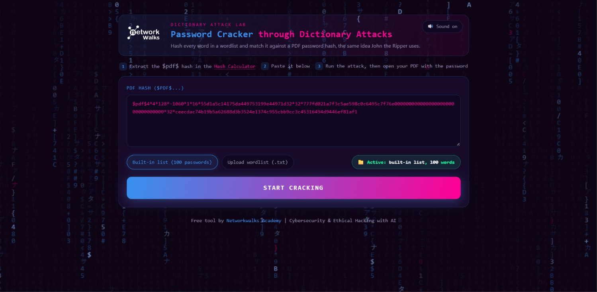
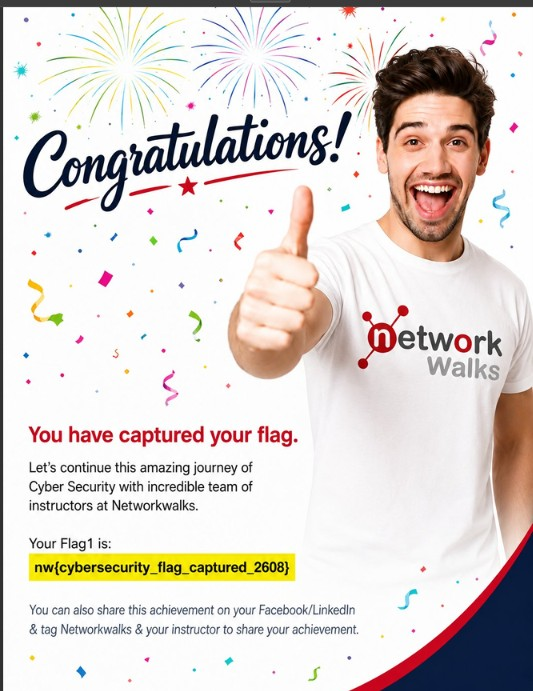
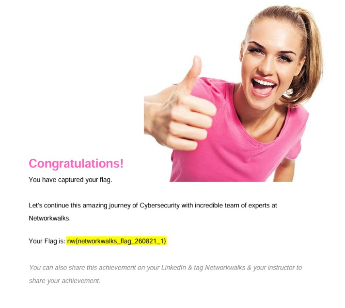
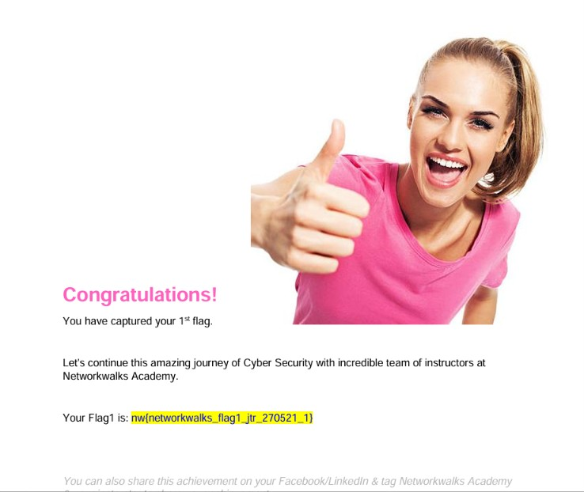
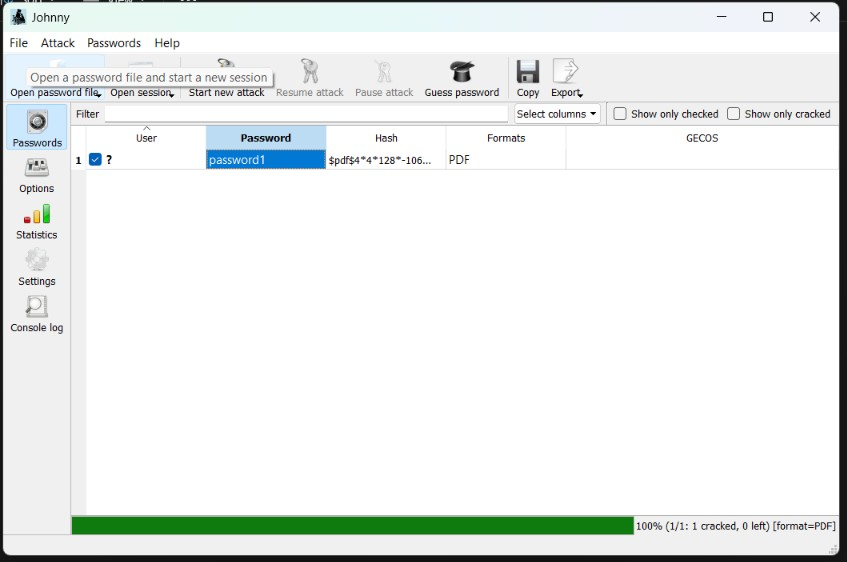

# 🔐 Penetration Testing: Password cracking 

**Building an isolated virtual lab for penetration testing and ethical hacking practice**

  
  
  
  
  
  
  
  
  
  

# NetworkWalks Ethical Hacking Lab: Password Cracking & Flag Capture Report

## 📌 Overview
This repository documents practical exercises completed during the **NetworkWalks** Ethical Hacking / Cybersecurity training, focusing on offline password auditing and cracking using **John the Ripper (JTR)**—including both CLI workflows and the **Johnny** GUI—alongside NetworkWalks password-cracking challenges.

> **Disclaimer:** All testing and password-cracking exercises documented here were performed strictly in authorized lab/training environments for educational purposes.

---

## 🛠️ Tools & Concepts Covered
* **John the Ripper (JTR) & Johnny GUI:** Offline password hash cracking, wordlist/dictionary attacks, session management, and format detection (`PDF` hashes).
* **Hash Extraction & Wordlists:** Extracting hashes from protected files (e.g., `pdf2john`) and applying targeted wordlists with patience and iterative testing.
* **Additional NetworkWalks Cracking Tools:** *(Add any extra tools covered in your module, e.g., `Hashcat`, `Hydra`, `zip2john`, `7z2john`, `rockyou.txt`, or custom wordlists).*

---

## 🔍 Practical Walkthrough: Cracking a Protected PDF with Networkwalks tools

1. **Extract / Load the Target Hash:** Load the target hash file into **Johnny** (the graphical frontend for John the Ripper), where the format is identified (e.g., `PDF` hash starting with `$pdf$4*4*128*...`).
2. **Configure & Start the Attack:** Select the attack mode/wordlist and run the cracking session (`Start new attack` / `Guess password`).
3. **Verify Cracked Credentials:** Monitor progress until completion (`100%` cracked) and confirm the recovered password (`password1`).

### Evidence: Networkwalks Cracking Session

* **Target Format:** `PDF` (`$pdf$4*4*128*-106...`)
* **Recovered Password:** `password1`
* **Status:** `100% (1/1: 1 cracked, 0 left)`

---

## 🚩 Captured Flags Summary

| Challenge / Screenshot | Captured Flag | Key Takeaway |
| :--- | :--- | :--- |
| **Flag 1 (`cracked 1.jpg`)** | `nw{cybersecurity_flag_captured_2608}` | Foundational flag capture & verification workflow |
| **Flag (`cracked 2.jpg`)** | `nw{networkwalks_flag_260821_1}` | Applying methodical enumeration and cracking steps |
| **JTR Flag 1 (`Screenshot 2026-11-20 123740.jpg`)** | `nw{networkwalks_flag1_jtr_270521_1}` | Initial John the Ripper password-cracking exercise |
| **Persistence JTR Flag (`Cracked password.jpg`)** | `nw{networkwalks_persistence_jtr_270521}` | Persistence, wordlist selection, and security-tester mindset |

### Flag Screenshots
* **Flag 1:** 
* **Flag 2:** 
* **Flag 3:** 
* **JTR :** 

---

## 🧠 Key Lessons Learned
* **Wordlists & Persistence Matter:** Password cracking success depends heavily on choosing relevant wordlists, rule sets, and staying patient through attack runs.
* **CLI vs. GUI Workflows:** Using **Johnny** helps visualize hash formats, sessions, and cracked results quickly, while the **John the Ripper** CLI gives finer control over custom wordlists, rules, and `--show` output.
* **Defensive Takeaway:** Weak or predictable passwords (such as `password1`) are recovered rapidly once a hash is exposed—strong password policies and proper access controls are essential.

---

Pentester: Ampfarisaho Masutha 
---

### 🌐 Connect With Me
* **Program:** NetworkWalks Cybersecurity Internship

